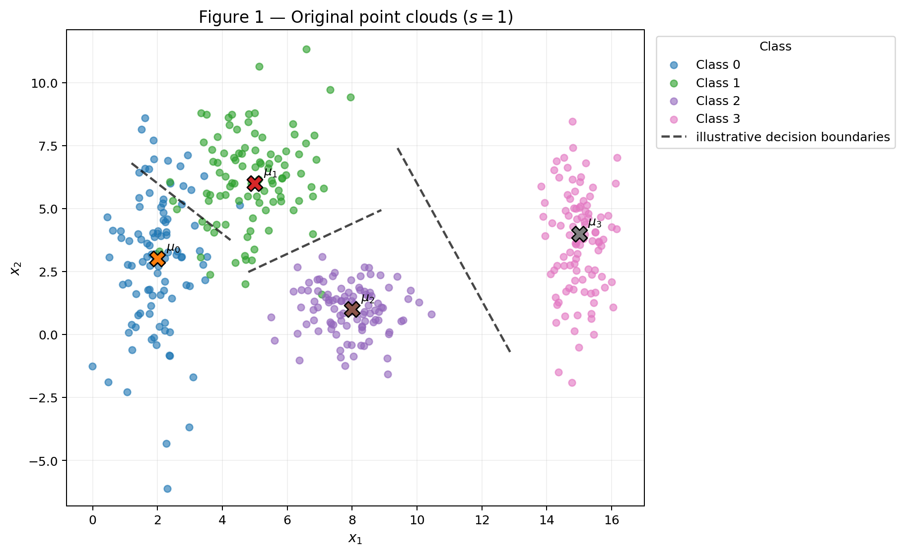
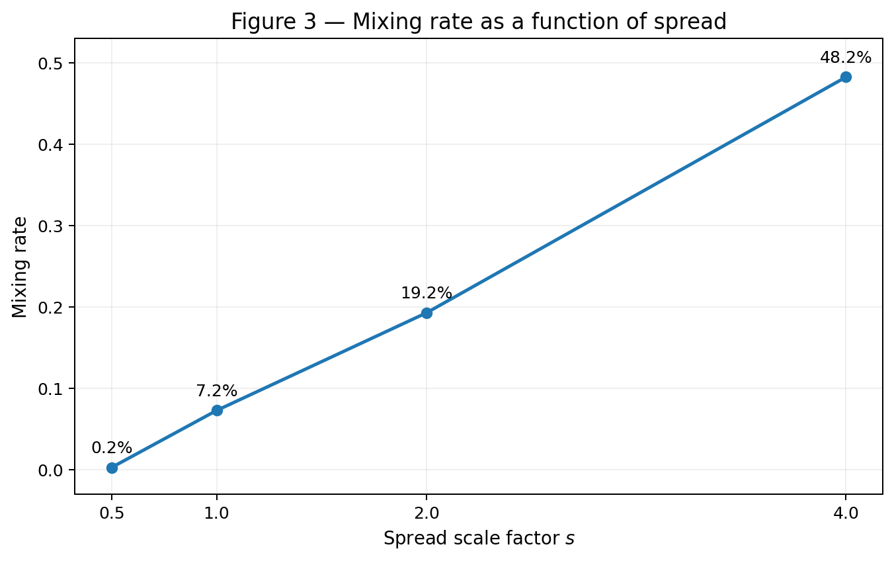
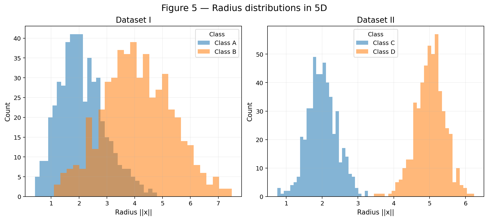

# 01 · Data

*Artificial Neural Networks and Deep Learning · Insper · 2026.2*

This report studies how the geometry, spread, dimensionality, and preprocessing of data affect the structure and difficulty of a classification problem. It follows one central idea: before choosing a neural-network architecture, it is necessary to understand the distribution of the data that the model will receive.

!!! info "Reproducibility"
    The entire activity uses one random-number generator, initialized exactly once with `rng = np.random.default_rng(42)`. The same `rng` instance is reused throughout the report. The complete implementation is available in [`data_activity.py`](code/data_activity.py).


## 1 Point Clouds: Geometry and Spread in 2D

Understanding how data is distributed is the first step before designing a network architecture. In this exercise the idea is to generate and measure two-dimensional point clouds, observing how the distribution affects the complexity of the decision boundaries a neural network would need to learn.

### 1.A Generate the Clouds

Four Gaussian synthetic point clouds were generated in two dimensions, with 100 samples per class. The means and standard deviations follow the given configuration:

| Class | Mean | Standard deviation |
|-------|------|--------------------|
| 0 | (2, 3) | (0.8, 2.5) |
| 1 | (5, 6) | (1.2, 1.9) |
| 2 | (8, 1) | (0.9, 0.9) |
| 3 | (15, 4) | (0.5, 2.0) |

The points are generated independently for each coordinate according to the corresponding Gaussian distribution. The markers in Figure 1 represent the specified class means rather than sample means.



**Figure 1 — Original point clouds ($s=1$).** The `X` markers indicate the class centers. The dashed curves are only a qualitative sketch of possible nonlinear decision boundaries; no classifier was trained for this figure.

The implementation used for the four classes is:

```python
rng = np.random.default_rng(42)

for k, (mu, sigma) in enumerate(zip(MEANS, STDS)):
    points = rng.normal(
        loc=mu,
        scale=sigma,
        size=(100, 2),
    )
```

### B — More or less spread out

To isolate the effect of dispersion, the same four class means were kept fixed while every standard deviation was multiplied by a scale factor

$$
 s \in \{0.5,\ 1.0,\ 2.0,\ 4.0\}.
$$

This creates four independent datasets, each containing the same four classes with 100 points per class.


**Figure 2 — Effect of increasing the spread.** All four subplots use the same axis limits, so the visual comparison reflects only the change in dispersion.

For $s=1$, the separation ratio was calculated as

$$
r_{ij}=\frac{\lVert\mu_i-\mu_j\rVert}{\bar\sigma_i+\bar\sigma_j},
\qquad
\bar\sigma_k=\frac{\sigma_{k,x}+\sigma_{k,y}}{2}.
$$

The six pairwise ratios are:

| Pair | Center distance | $r_{ij}$ |
| --- | ---: | ---: |
| $(0,1)$ | 4.2426 | **1.3258** |
| $(0,2)$ | 6.3246 | 2.4802 |
| $(0,3)$ | 13.0384 | 4.4960 |
| $(1,2)$ | 5.8310 | 2.3800 |
| $(1,3)$ | 10.1980 | 3.6422 |
| $(2,3)$ | 7.6158 | 3.5422 |

The smallest ratio is therefore obtained by **classes 0 and 1**, with $r_{01}=1.3258$. Because the means stay fixed while all standard deviations are multiplied by $s$, every separation ratio scales as $1/s$. Consequently,

$$
r_{01}(s=2)=\frac{1.3258}{2}\approx\mathbf{0.6629}.
$$

The mixing rate is defined geometrically as the fraction of points whose nearest class center is not the center of their own class. Using the specified class means as the reference centers gives:

| Spread factor $s$ | Mixing rate |
| ---: | ---: |
| 0.5 | **0.25%** |
| 1.0 | **7.25%** |
| 2.0 | **19.25%** |
| 4.0 | **48.25%** |



**Figure 3 — Mixing rate versus spread factor.** The geometric mixing increases monotonically as the standard deviations grow.

The trend is clear: increasing the spread does not move the class centers, but it increases the volume of the regions occupied by each class. As a result, points from different classes increasingly enter each other's neighborhoods.

### C — Analysis

At $s=1$, the four classes are still organized around distinct centers, but classes 0 and 1 already show the most relevant overlap. A set of straight boundaries can approximate the partition of the four cluster centers, but perfect separation is already lost in the generated sample: the mixing rate is 7.25%. In other words, there is no set of linear boundaries that can classify every sampled point correctly.

The effect becomes substantially stronger at $s=2$. The smallest separation ratio falls from 1.3258 to approximately 0.6629, while the mixing rate increases to 19.25%. At this point, the class regions around the first three centers overlap enough that straight boundaries are no longer a convincing description of the class structure. At $s=4$, almost half of the points are geometrically assigned to a different nearest class center, indicating severe mixing.

The dashed curves in Figure 1 are therefore best interpreted as a qualitative sketch of what a nonlinear classifier could learn: the boundaries can bend around the dense regions instead of being constrained to one global line. As the clouds become more dispersed, these uncertain boundary regions necessarily become wider, increasing the portion of the input space where classification becomes ambiguous.

The key lesson from this exercise is that **spread is not merely a visualization property**. It directly changes the overlap between classes and therefore changes the complexity and difficulty of the decision problem that a neural network has to learn.

---

## Exercise 2

### A — Dataset I: shifted Gaussians

Dataset I contains 500 samples from Class A and 500 from Class B in five dimensions. The classes have different mean vectors and different covariance matrices, so both their centers and their shapes contribute to the classification problem.

Class A uses

$$
\mu_A=[0,0,0,0,0],
$$

with the covariance matrix specified in the statement. Class B uses

$$
\mu_B=[1.5,1.5,1.5,1.5,1.5],
$$

with its corresponding covariance matrix. The complete matrices are encoded directly in [`data_activity.py`](code/data_activity.py).

The Euclidean distance between the two class centers is

$$
\lVert\mu_A-\mu_B\rVert = \mathbf{3.3541}.
$$

This nonzero displacement gives the classes a clear directional difference in the original five-dimensional space.

### B — Dataset II: concentric shells

Dataset II also contains 500 samples per class, but the geometry is fundamentally different. For every sample, a five-dimensional direction is generated from a standard Gaussian vector and normalized to unit length. The radius is then drawn independently for the two classes:

- Class C: $\rho\sim\mathcal N(2.0,0.4)$
- Class D: $\rho\sim\mathcal N(5.0,0.4)$

The final point is

$$
 x=\rho u,
$$

where $u$ is a unit vector. The result is an inner cloud surrounded by an outer shell.

Because the directions are approximately symmetric around the origin, the class centers are both close to zero. In this realization, their distance is only

$$
\lVert\mu_C-\mu_D\rVert=\mathbf{0.2215}.
$$

This is the central contrast of the exercise: the centers are almost coincident even though the classes are well separated by radius.

### C — Visualize and compare

Since the datasets live in five dimensions, PCA was used to obtain a two-dimensional linear projection.


**Figure 4 — PCA projections into two dimensions.** Dataset I retains a visible directional separation, whereas the two shell classes in Dataset II appear heavily mixed after projection.

The first two principal components explain:

| Dataset | PC1 + PC2 explained variance |
| --- | ---: |
| Dataset I | **67.35%** |
| Dataset II | **42.27%** |

The 2D projection therefore preserves more of the overall variance of Dataset I. More importantly, in Dataset I this preserved variance contains information related to the displacement between the class centers. In Dataset II, the classification-relevant information is radial and is not preserved as a simple separation in the first two principal components.

The relevant five-dimensional center distances are:

| Dataset | Center distance |
| --- | ---: |
| I — A vs. B | **3.3541** |
| II — C vs. D | **0.2215** |

The radius distributions make the hidden structure of Dataset II explicit:



**Figure 5 — Radius distributions in the original five-dimensional space.** The shell classes are strongly separated by $\lVert x\rVert$, even though their centers are nearly identical.

### D — Analysis

Dataset II demonstrates why the distance between class centers is not sufficient to characterize a classification problem. Its centers are almost coincident, but the two classes occupy different radial regions. A hyperplane cannot isolate an inner ball from a surrounding shell: any straight boundary that keeps the origin on one side necessarily cuts through the surrounding directions, because the shell extends around the core in every direction.

This means that **no linear boundary can perfectly separate the two classes**, regardless of the number of samples available. More data would estimate the same nonlinear geometry more accurately, but it would not change the fact that the required boundary is curved.

The poor-looking PCA projection does not prove that Dataset II is inseparable in the original space. PCA is a linear dimensionality-reduction method that keeps directions of greatest variance; it does not guarantee preservation of the feature that best separates classes. Here, the relevant feature is radial distance.

A simple function that separates the two shell classes is

$$
 f(x)=\lVert x\rVert^2=\sum_{i=1}^{5}x_i^2.
$$

A threshold $t$ between the two radius ranges can then be used to classify the samples:

$$
\hat y =
\begin{cases}
C, & f(x) < t,\\
D, & f(x) \ge t.
\end{cases}
$$

Thus, the original space contains a simple nonlinear rule even though a two-dimensional PCA projection can make the classes look almost indistinguishable.

---

## Exercise 3

### A — Get to know the data

The real-world dataset is the **Spaceship Titanic** training set from Kaggle. The target `Transported` indicates whether a passenger was transported to another dimension. The original training set contains 8,693 labeled passengers, with 4,378 transported and 4,315 not transported, corresponding to a positive-class share of **50.36%**. The dataset is therefore close to balanced.

The features can be divided into numerical and categorical variables:

| Type | Features |
| --- | --- |
| Numerical | `Age`, `RoomService`, `FoodCourt`, `ShoppingMall`, `Spa`, `VRDeck` |
| Categorical | `HomePlanet`, `CryoSleep`, `Cabin`, `Destination`, `VIP`, `Name`, `PassengerId` |
| Target | `Transported` |

The assignment asks that `Cabin`, `Name`, and `PassengerId` be removed during preprocessing because they are identifiers or high-cardinality fields rather than direct numerical predictors.

The spending variables are strongly right-skewed. For the complete labeled dataset, for example, `FoodCourt` has a mean around 458.08 while its median is 0, meaning that most passengers spend nothing while a relatively small number of passengers generate very large values. This difference between mean and median is a direct signal of a heavy-tailed distribution.

### B — Split before you transform

The dataset is split into 80% training and 20% test data **before** fitting any imputer, encoder, or scaler. The split is stratified by `Transported` and uses the same global random-number generator used elsewhere in the report.

This ordering prevents data leakage. If a median, standard deviation, or observed category were calculated using the complete dataset, information from the test set would influence the transformation applied to the training data. The resulting preprocessing would therefore indirectly expose information about data that should remain unseen until evaluation.

The split is implemented manually so that the same `rng` instance is reused throughout the entire activity:

```python
def stratified_split(X, y, test_size=0.2):
    train_idx, test_idx = [], []
    for cls in np.unique(y):
        idx = np.flatnonzero(y == cls)
        idx = rng.permutation(idx)
        n_test = int(round(test_size * len(idx)))
        test_idx.extend(idx[:n_test])
        train_idx.extend(idx[n_test:])
    return rng.permutation(train_idx), rng.permutation(test_idx)
```

### C — Preprocess

The numerical variables are imputed with the **training-set median**, which is more robust than the mean for strongly skewed spending variables. The categorical variables are filled with their most frequent training category.

The four categorical predictors requested by the statement are one-hot encoded. The encoder uses `handle_unknown="ignore"`, so a category that appears in the test set but was not observed during training does not cause an error; it simply contributes zeros to the corresponding one-hot representation.

The five spending variables are transformed with

$$
 x' = \log(1+x),
$$

which compresses the extreme right tail while preserving zero as zero. This produces a much more manageable numerical range for a network with `tanh` activations.

After the logarithmic transformation, the engineered `TotalSpend` feature is computed as the sum of the five transformed spending variables. The fields `Cabin`, `Name`, and `PassengerId` are then removed.

Finally, the numerical variables are standardized using the training data only. Standardization was chosen because it produces centered, unit-scale numerical inputs while avoiding the dependence of MinMax scaling on the particular sample extremes. The categorical one-hot features remain in the $[0,1]$ range.

The full preprocessing implementation is available in [`data_activity.py`](code/data_activity.py). The important training-only fitting steps are:

```python
medians = X_train[numeric_base].median()
X_train[numeric_base] = X_train[numeric_base].fillna(medians)
X_test[numeric_base] = X_test[numeric_base].fillna(medians)

encoder = OneHotEncoder(
    handle_unknown="ignore",
    sparse_output=False,
)
train_cat = encoder.fit_transform(X_train[CATEGORICAL])
test_cat = encoder.transform(X_test[CATEGORICAL])

scaler = StandardScaler()
train_num = scaler.fit_transform(X_train[NUMERICAL])
test_num = scaler.transform(X_test[NUMERICAL])
```

### D — Verify and visualize

Figure 6 shows the effect of the logarithmic transformation on `FoodCourt`.

**Figure 6 — `FoodCourt` before and after preprocessing.** This figure is generated by the reproducible script once `train.csv` is available locally. It compares the raw training distribution with `log(1 + FoodCourt)` and should show the expected compression of the long right tail.

The final checks are generated automatically by the same script after `train.csv` is placed in `data/`.

!!! warning "Dataset required to finish Exercise 3"
    The Kaggle `train.csv` file is intentionally not bundled with this repository. Place it at `docs/activities/data/data/train.csv` and run `python docs/activities/data/code/data_activity.py`. The script will generate Figure 6 and print the exact training/test statistics required in the Results Summary below.

The pipeline should satisfy three final conditions: there are no remaining `NaN` values, the final feature matrix has a finite numerical shape, and the scaled numerical inputs are centered and on a range appropriate for a `tanh`-based network.

The preprocessing decision expected to have the largest impact on training is the combination of **heavy-tail compression and scaling**. Without these steps, a few very large spending values would dominate the numerical scale of the inputs, forcing the network to operate in a poorly conditioned region and potentially pushing `tanh` units toward saturation. The imputation and categorical encoding are also necessary for a complete numerical matrix, but the log transformation and scaling directly affect the numerical geometry seen by every layer.

---

## Results Summary

The following table collects the numerical results already discussed above. The values for Exercises 1 and 2 are fixed by the reproducible generation in this report. The remaining training-dependent values are populated automatically after the original Kaggle `train.csv` is supplied.

| # | Item | Your value |
| ---: | --- | ---: |
| 1 | Mixing rate at $s=0.5$ | **0.25%** |
| 2 | Mixing rate at $s=1.0$ | **7.25%** |
| 3 | Mixing rate at $s=2.0$ | **19.25%** |
| 4 | Mixing rate at $s=4.0$ | **48.25%** |
| 5 | Smallest $r_{ij}$ at $s=1.0$, and pair | **1.3258 — classes (0, 1)** |
| 6 | Distance between centers — Dataset I | **3.3541** |
| 7 | Distance between centers — Dataset II | **0.2215** |
| 8 | Explained variance PC1 + PC2 — Dataset I | **67.35%** |
| 9 | Explained variance PC1 + PC2 — Dataset II | **42.27%** |
| 10 | Share of the positive class in `Transported` | **50.36%** |
| 11 | Mean and median of `FoodCourt` on the training set, before transforming | **Generated from the stratified training split** |
| 12 | Final shape of the training feature matrix | **Generated after preprocessing** |
| 13 | Minimum and maximum of the training and test sets after scaling | **Generated after preprocessing** |

### AI collaboration disclosure

Generative AI was used as a programming and writing aid during the preparation of this report. The student is responsible for reviewing, understanding, testing, and validating all code, figures, calculations, and explanations included in the submission.
