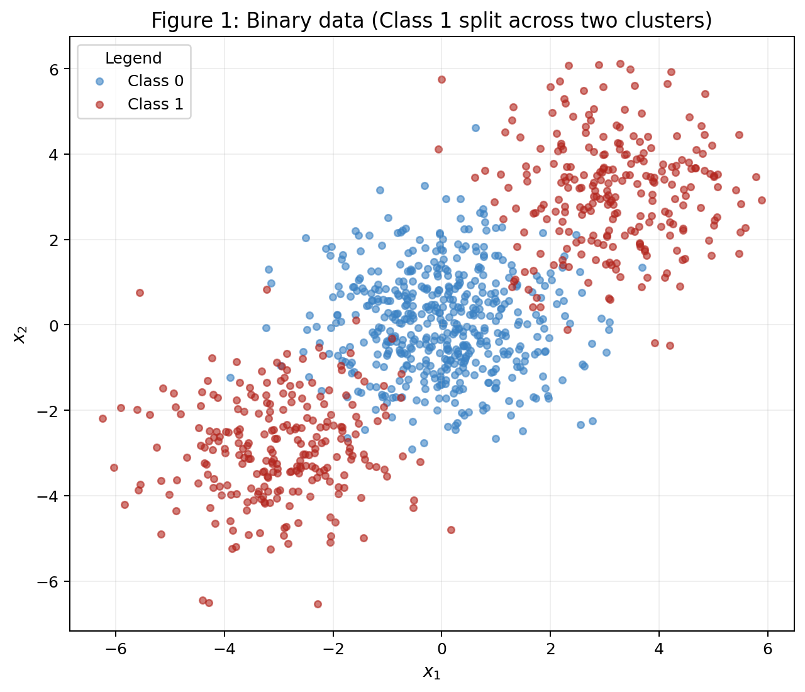
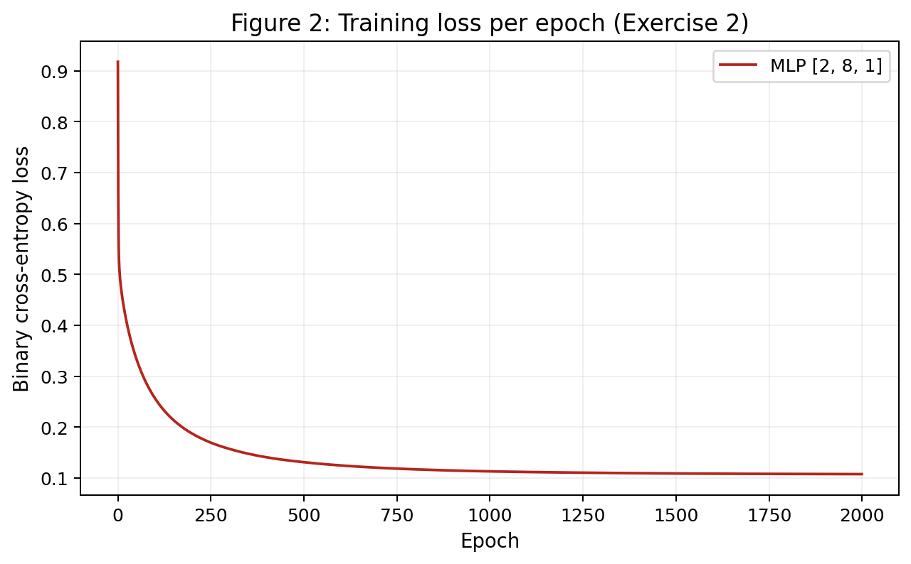
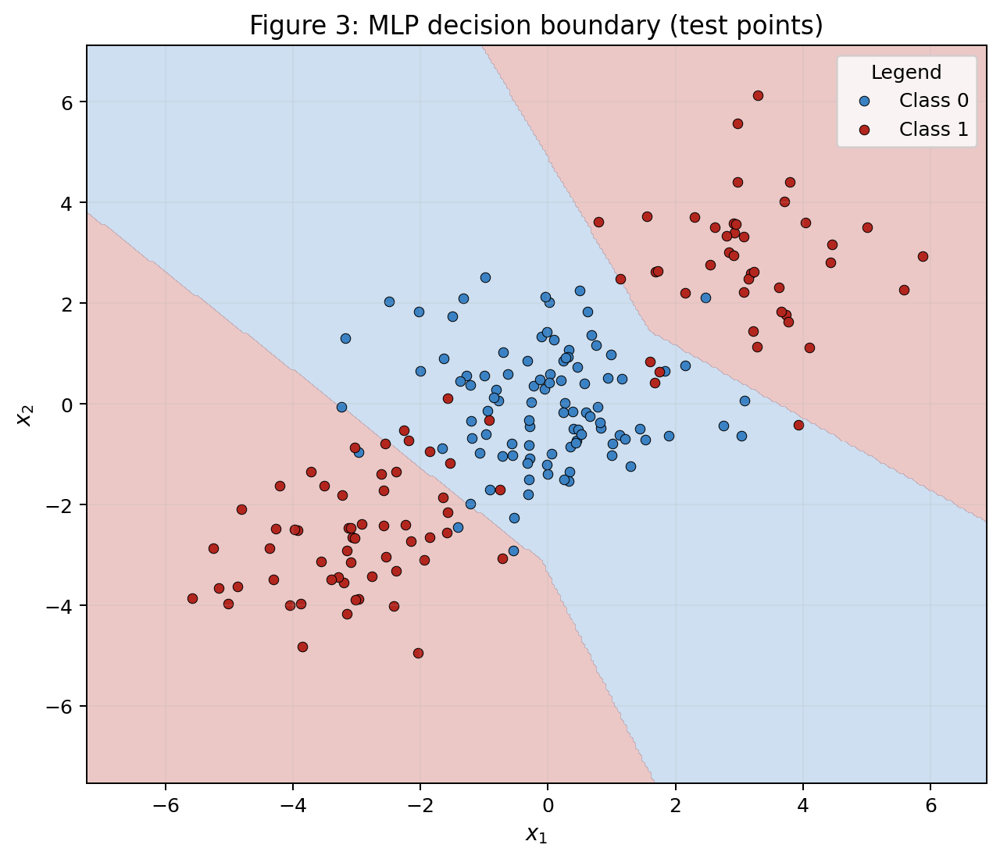
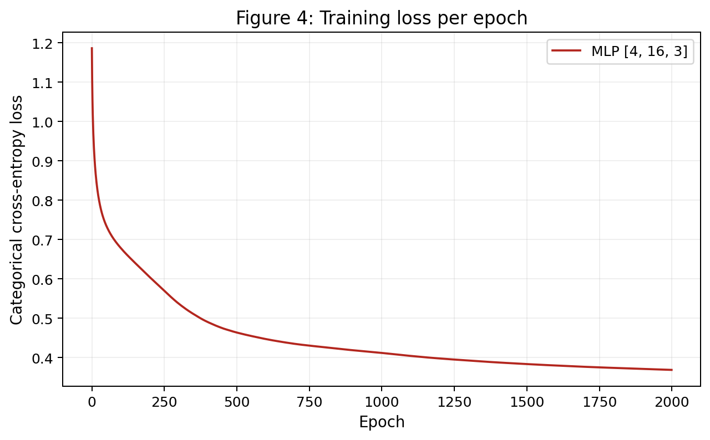
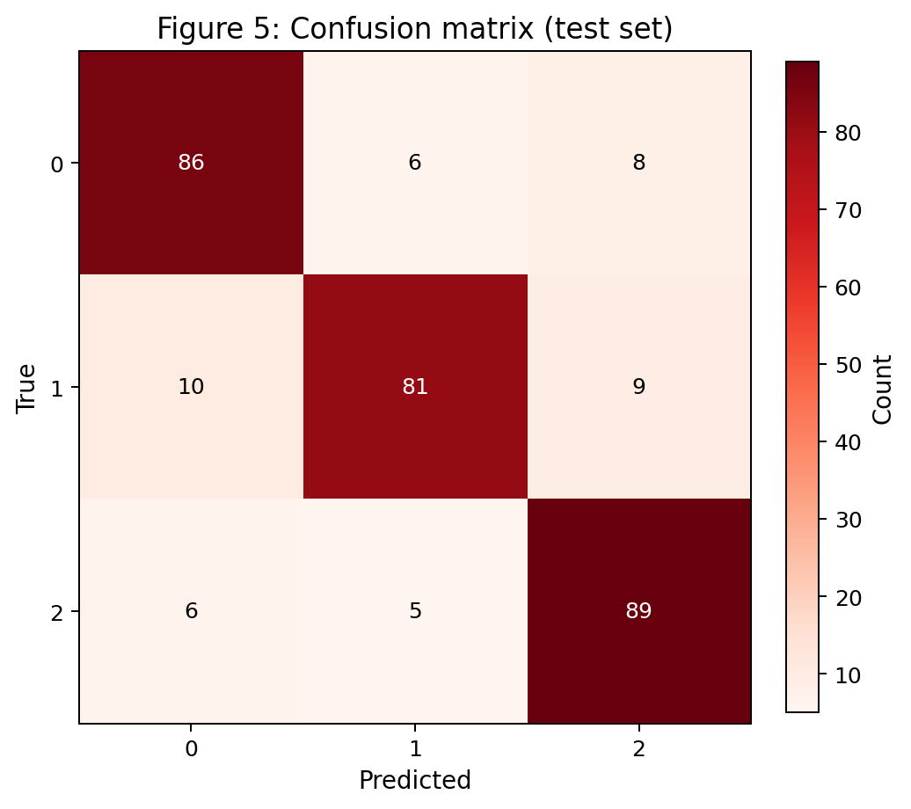
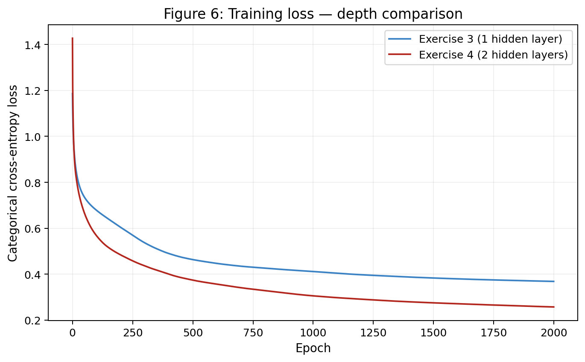

# 3 · MLP

<span class="nn-deadline">📅 Deadline: 22.sep.2026</span>

This report follows **what a hidden layer buys you**: one exercise done by hand to see backpropagation move every parameter, then a dataset no straight line can touch, then more classes, and finally a check on whether a second hidden layer helps at all.

!!! info "Reproducibility"
    A single `rng = np.random.default_rng(42)` is created once and reused throughout the whole report. The full implementation for Exercises 2–4 is in [`mlp_activity.py`](code/mlp_activity.py); Exercise 1 is worked entirely by hand below.

## Exercise 1

### One Step of Backpropagation, by Hand

Network: 2 inputs, 1 hidden layer of 2 neurons, 1 output neuron, $\tanh$ on both layers, MSE loss with $N=1$: $L=(y-\hat y)^2$.

Given: $\mathbf{x}=[0.5,-0.2]$, $y=1.0$, $\mathbf{W}^{(1)}=\begin{bmatrix}0.3&-0.1\\0.2&0.4\end{bmatrix}$, $\mathbf{b}^{(1)}=[0.1,-0.2]$, $\mathbf{W}^{(2)}=[0.5,-0.3]$, $b^{(2)}=0.2$, $\eta=0.3$.

### A — Forward pass

$$
\mathbf{z}^{(1)} = \mathbf{W}^{(1)}\mathbf{x}+\mathbf{b}^{(1)}
= \begin{bmatrix}0.3(0.5)+(-0.1)(-0.2)+0.1\\0.2(0.5)+0.4(-0.2)-0.2\end{bmatrix}
= [0.2700,\ -0.1800]
$$

$$
\mathbf{h}^{(1)} = \tanh(\mathbf{z}^{(1)}) = [0.2636,\ -0.1781]
$$

$$
u^{(2)} = \mathbf{W}^{(2)}\cdot\mathbf{h}^{(1)}+b^{(2)} = 0.5(0.2636)-0.3(-0.1781)+0.2 = 0.3852
$$

$$
\hat y = \tanh(u^{(2)}) = 0.3672, \qquad L = (1.0-0.3672)^2 = 0.4004
$$

### B — Backward pass

$$
\frac{\partial L}{\partial \hat y} = -2(y-\hat y) = -2(1.0-0.3672) = -1.2655
$$

$$
\frac{\partial L}{\partial u^{(2)}} = \frac{\partial L}{\partial \hat y}\,(1-\hat y^2) = -1.2655 \times (1-0.3672^2) = -1.0948
$$

Output layer:

$$
\frac{\partial L}{\partial \mathbf{W}^{(2)}} = \frac{\partial L}{\partial u^{(2)}}\,\mathbf{h}^{(1)} = -1.0948 \times [0.2636,\ -0.1781] = [-0.2886,\ 0.1950]
$$

$$
\frac{\partial L}{\partial b^{(2)}} = \frac{\partial L}{\partial u^{(2)}} = -1.0948
$$

Propagate back:

$$
\frac{\partial L}{\partial \mathbf{h}^{(1)}} = \frac{\partial L}{\partial u^{(2)}}\,\mathbf{W}^{(2)} = -1.0948\times[0.5,\ -0.3] = [-0.5474,\ 0.3284]
$$

$$
\frac{\partial L}{\partial \mathbf{z}^{(1)}} = \frac{\partial L}{\partial \mathbf{h}^{(1)}} \odot (1-(\mathbf{h}^{(1)})^2) = [-0.5474(1-0.2636^2),\ 0.3284(1-0.1781^2)] = [-0.5094,\ 0.3180]
$$

Hidden layer:

$$
\frac{\partial L}{\partial \mathbf{W}^{(1)}} = \frac{\partial L}{\partial \mathbf{z}^{(1)}}\,\mathbf{x}^T =
\begin{bmatrix}-0.5094(0.5) & -0.5094(-0.2)\\0.3180(0.5) & 0.3180(-0.2)\end{bmatrix} =
\begin{bmatrix}-0.2547 & 0.1019\\0.1590 & -0.0636\end{bmatrix}
$$

$$
\frac{\partial L}{\partial \mathbf{b}^{(1)}} = \frac{\partial L}{\partial \mathbf{z}^{(1)}} = [-0.5094,\ 0.3180]
$$

### C — Parameter update

With $\eta=0.3$:

$$
\mathbf{W}^{(2)} \leftarrow [0.5,-0.3] - 0.3[-0.2886,\ 0.1950] = [0.5866,\ -0.3585]
$$

$$
b^{(2)} \leftarrow 0.2 - 0.3(-1.0948) = 0.5284
$$

$$
\mathbf{W}^{(1)} \leftarrow \begin{bmatrix}0.3&-0.1\\0.2&0.4\end{bmatrix} - 0.3\begin{bmatrix}-0.2547&0.1019\\0.1590&-0.0636\end{bmatrix} = \begin{bmatrix}0.3764&-0.1306\\0.1523&0.4191\end{bmatrix}
$$

$$
\mathbf{b}^{(1)} \leftarrow [0.1,-0.2]-0.3[-0.5094,\ 0.3180] = [0.2528,\ -0.2954]
$$

Recomputing the forward pass with the updated parameters gives $L_{\text{new}} = 0.0834$, **down** from $L=0.4004$ — the loss decreases on the second forward pass, as expected after a gradient-descent step in the direction that reduces the loss.

---

## Exercise 2

### Binary Classification a Straight Line Cannot Do

### A — Generate the data

Class 1 is split into two clusters on opposite sides of Class 0 (`make_blobs`, centers $[0,0]$, $[3,3]$, $[-3,-3]$, `cluster_std=1.2`, `random_state=42`), so no straight line can separate the classes. Split 80/20 stratified.



### B — Establish the baseline

A `LogisticRegression` fit on the training set scores **47.50%** on the test set — worse than guessing, as expected, because the two halves of Class 1 sit on opposite sides of Class 0 and a single line cannot enclose both.

### C — Implement the MLP

An MLP was implemented entirely from scratch (`MLP` class in the code below: forward pass, binary cross-entropy loss, backward pass with every gradient derived, and the update step), with layer sizes taken as a constructor argument so the same class serves Exercises 2, 3 and 4 unchanged.

```python
--8<-- "docs/exercises/mlp/code/mlp_activity.py"
```

**Architecture:** `[2, 8, 1]` (one hidden layer of 8 ReLU units, sigmoid output). **Learning rate:** 0.1. **Epochs:** 2000. **Test accuracy: 92.50%**, within the expected 90–93% range.





### D — Analysis

The linear baseline scores *below* 50% because Class 1 forms two separate clusters placed on opposite sides of Class 0 — any single straight line that tries to keep both Class-1 clusters on the same side inevitably also keeps a large chunk of Class 0 on that side, and logistic regression finds the least-bad *line*, which here is actively worse than a coin flip on this particular split. Figure 3 shows the region the MLP assigns to Class 1: it is not a half-plane but two separate wedges, one in the upper-right and one in the lower-left, hugging the two true Class-1 clusters while leaving the central region (Class 0) as a connected "island" of the opposite prediction. No single straight line can produce two disconnected regions of the same class separated by a region of the other class — that requires at least one bend, which is exactly what the hidden layer's ReLU units contribute.

---

## Exercise 3

### Multi-Class, Same Network

### A — Generate the data

`make_classification` with 1500 samples, 4 informative features, 3 classes, 2 clusters per class, `class_sep=1.0`, `random_state=42`. Split 80/20 stratified.

### B — Adapt the network

The output layer now has 3 units with **softmax**, and the loss is **categorical cross-entropy**. For softmax + cross-entropy, writing $p_k = \text{softmax}(u)_k$ and $L=-\sum_k y_k\log p_k$ with one-hot $y$, the derivative simplifies to

$$
\frac{\partial L}{\partial u_k} = p_k - y_k,
$$

the same simple "prediction minus target" form as the sigmoid + binary-cross-entropy case in Exercise 2. This is why the `train` method in the code uses `delta = (as_[-1] - y_target) / n` for **both** the sigmoid and softmax output layers — the two losses were chosen specifically so that this term has the same shape, which is what let the exact same backward-pass code serve both cases.

**Extra point — verbatim reuse.** The `MLP` class used here is *exactly* the same class used in Exercise 2, with only the constructor arguments changed (`layer_sizes=[4, 16, 3]`, `output_activation="softmax"`); the `forward`, `train` and `predict` methods were not touched.

### C — Train and evaluate

**Architecture:** `[4, 16, 3]`. **Learning rate:** 0.1. **Epochs:** 2000. **Test accuracy: 85.33%**, within the expected 83–86% range. Logistic-regression baseline on the same split: **66.33%**, close to the ~66% reference.





### D — Analysis

According to the confusion matrix in Figure 5, the network confuses **true class 1 with predicted class 0** most (10 samples), closely followed by the symmetric class 0 → class 1 and class 1 → class 2 confusions. The data has 4 informative dimensions but 6 clusters total (2 per class, 3 classes) — with only 4 dimensions to arrange 6 cluster centers and a moderate `class_sep=1.0`, some clusters belonging to different classes inevitably end up closer to each other than to their own class's other cluster, and class 1 in particular seems to have at least one of its two clusters positioned in a crowded region of feature space shared with class 0. The hidden layer lifts test accuracy from the 66.33% linear baseline to 85.33% precisely because it can bend the boundary around each of the 6 clusters individually instead of being restricted to a small number of straight cuts through a 4D space.

---

## Exercise 4

### Does a Second Hidden Layer Help?

Same data, seed, and training budget as Exercise 3; the only change is depth.

### A — Train the deeper network

**Architecture:** `[4, 16, 8, 3]` (2 hidden layers), same 2000 epochs and $\eta=0.1$ as Exercise 3. **Test accuracy: 84.00%.**

### B — Compare



| | hidden layers | parameters | final train loss | test accuracy |
| --- | --- | --- | --- | --- |
| Exercise 3 | 1 | 131 | 0.3686 | 0.8533 |
| Exercise 4 | ≥ 2 | 243 | 0.2575 | 0.8400 |

Averaged over 5 seeds (42–46), same data/split/budget: **Exercise 3 mean accuracy = 84.40%**, **Exercise 4 mean accuracy = 85.20%** — a difference of **+0.80 percentage points** in favor of the deeper network, well within the run-to-run noise these small datasets produce; on the single seed used for the table above the deeper network actually did slightly *worse* (84.00% vs 85.33%).

### C — Analysis

The single-seed result (Exercise 4 worse) and the 5-seed averaged result (Exercise 4 marginally better by less than a percentage point) tell the same underlying story: depth does **not** meaningfully help here, even though the deeper network's final **training loss is lower** (0.2575 vs 0.3686 on the single-seed run) — it fits the training data more closely without a corresponding gain on the test set, a classic sign that the extra capacity is being spent on the training set's noise rather than on real structure. The data has only 6 clusters spread across 4 dimensions with moderate separation; a single hidden layer of 16 ReLU units already has more than enough representational capacity to carve out 6 regions, so a second layer adds optimization difficulty (more parameters to coordinate, more ways for gradients to be poorly scaled) without adding a capability the problem actually needs. Depth would be expected to pay off on data with genuinely **hierarchical or compositional** structure — for example, images where low-level edges must first be combined into shapes before shapes can be combined into objects — where a single layer, no matter how wide, cannot reuse features the way a stack of layers can.

---

## Results summary

| # | Quantity | Value |
| --- | --- | --- |
| 1 | Ex. 1 — $\mathbf{z}^{(1)}$ and $\mathbf{h}^{(1)}$ | $\mathbf{z}^{(1)}=[0.2700,-0.1800]$, $\mathbf{h}^{(1)}=[0.2636,-0.1781]$ |
| 2 | Ex. 1 — $u^{(2)}$, $\hat{y}$ and $L$ | $u^{(2)}=0.3852$, $\hat y=0.3672$, $L=0.4004$ |
| 3 | Ex. 1 — the eight updated parameters | $\mathbf{W}^{(2)}=[0.5866,-0.3585]$, $b^{(2)}=0.5284$, $\mathbf{W}^{(1)}=\begin{bmatrix}0.3764&-0.1306\\0.1523&0.4191\end{bmatrix}$, $\mathbf{b}^{(1)}=[0.2528,-0.2954]$ |
| 4 | Ex. 2 — linear baseline test accuracy | 47.50% |
| 5 | Ex. 2 — architecture and test accuracy | `[2, 8, 1]`, 92.50% |
| 6 | Ex. 3 — architecture and test accuracy | `[4, 16, 3]`, 85.33% |
| 7 | Ex. 3 — most-confused class pair | True 1 → Predicted 0 (10 samples) |
| 8 | Ex. 4 — architecture and test accuracy | `[4, 16, 8, 3]`, 84.00% (single seed) |
| 9 | Ex. 4 — accuracy difference against Ex. 3 (mean over ≥ 3 seeds) | +0.80 pp (5-seed mean: 85.20% vs 84.40%) |
