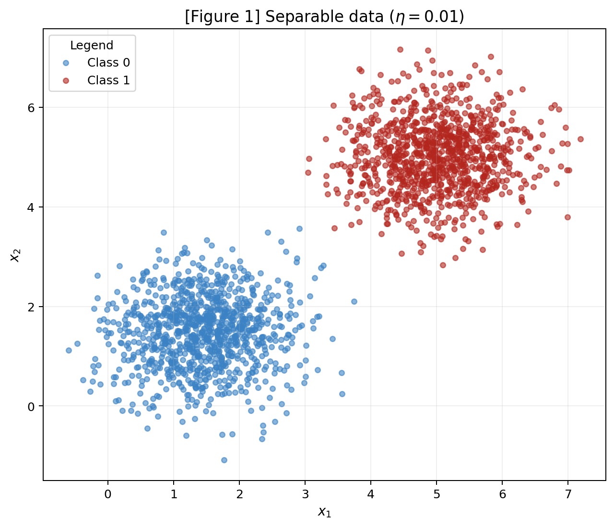
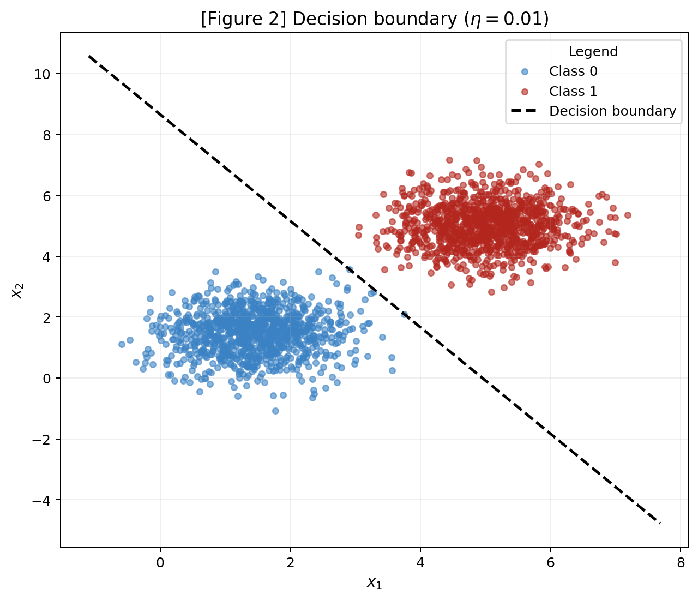
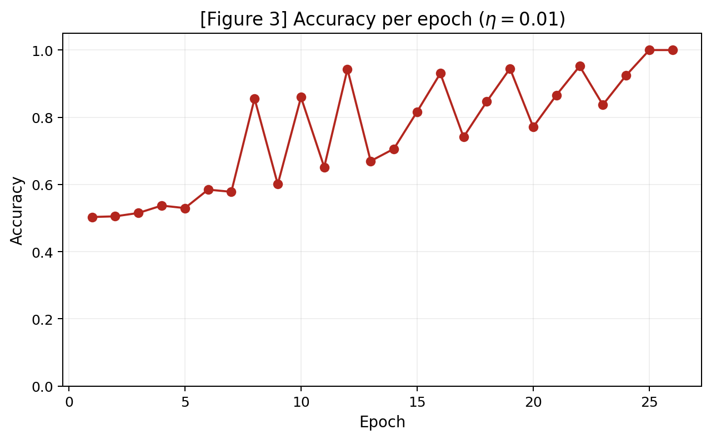
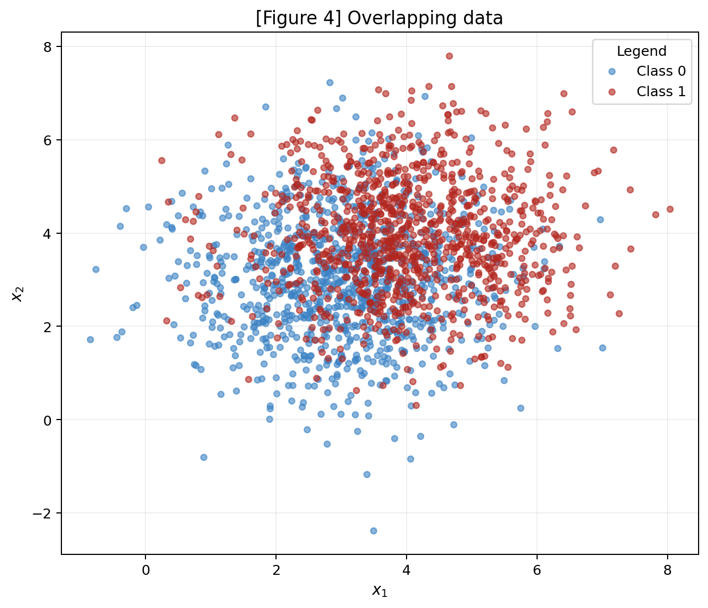
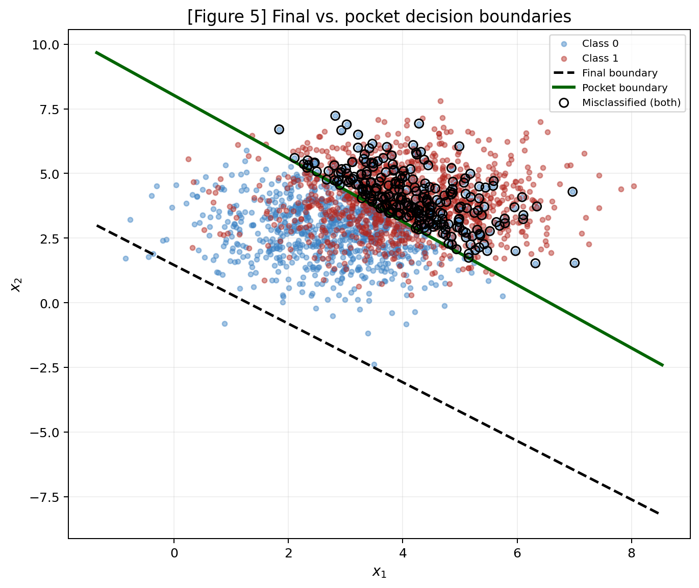
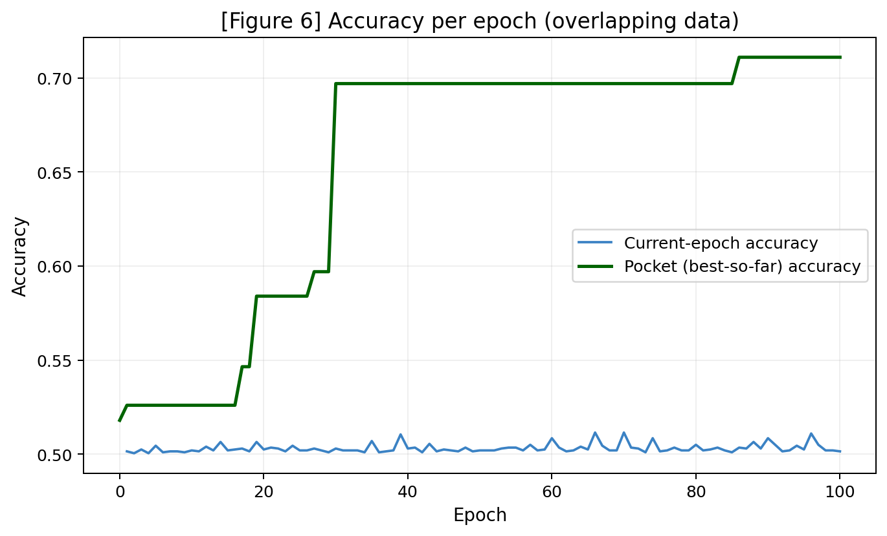

# 2 · Perceptron

This report studies **separability**: the same perceptron is trained on two datasets (one it can solve, one it cannot) and the interesting part is not that the second one fails, but *how* it fails.

!!! info "Reproducibility"
    A single `rng = np.random.default_rng(42)` is created once and reused throughout the whole report. The full implementation is in [`perceptron_activity.py`](code/perceptron_activity.py).

???+ "See `perceptron_activity.py`"
    ```python
    --8<-- "docs/exercises/perceptron/code/perceptron_activity.py"
    ```

## Exercise 1

### Separable Data: the case the perceptron was designed for

### A — Generate the data

Two classes ($c0$ and $c1$) of 2000 total points (1000 each) were generated from multivariate normal distributions with the following parameters:

$$
\begin{aligned}
    \mu_{c0} = 
        \begin{bmatrix}
        1.5 \\ 1.5
        \end{bmatrix}
    \quad
    \mu_{c1} =
        \begin{bmatrix}
        5 \\
        5
        \end{bmatrix}
\end{aligned}
$$

Both classes share the same covariance matrix:

$$
\Sigma =
    \begin{bmatrix}
        0.5 & 0 \\
        0 & 0.5
    \end{bmatrix}
$$

The means are far apart relative to the distributions' spread, making the classes linearly separable with at most a handful of overlapping points, as observed in Figure 1.




### B — Implement the perceptron

The perceptron was implemented from scratch as the `Perceptron` class in the code above (`perceptron_activity.py`). 

- **Prediction** is $\hat{y} = \text{step}(\mathbf{w}\cdot\mathbf{x}+b)$;
- **Update Rule** is $\mathbf{w} \leftarrow \mathbf{w} + \eta \cdot (y-\hat{y}) \cdot \mathbf{x}$ and $b \leftarrow b + \eta \cdot (y-\hat{y})$;
- **Weights** are initialized from `rng.normal(0, 0.01, size=2)` (non-zero) with $\eta = 0.01$;
- **Training stops** after a full epoch with no updates or after 100 epochs.

### C — Train and measure

Training converged in **26 epochs**, reaching **100% accuracy**, with the following final parameters

$$
\mathbf{w} = [0.0505,\ 0.0289] \qquad b = -0.2500
$$





### D — Analysis

> **1. Why does separable data converge quickly?** 

Each update only fires on a misclassified sample, and it moves $\mathbf{w}, b$ in the direction that fixes that particular mistake ($\mathbf{w} \leftarrow \mathbf{w} + \eta(y-\hat y)\mathbf{x}$). Because the two clouds are well separated, early updates already push the boundary toward the gap between them, so the fraction of misclassified points shrinks fast each epoch. As Figure 3 shows, accuracy rises steeply in the first handful of epochs and then flattens once the boundary sits inside the margin between clouds — from that point on, most samples produce no update at all, and only a few borderline points keep nudging the boundary until it clears every point.

> **2. Re-run the training with $\eta = 1.0$, changing nothing else. Report the epoch count and the final accuracy, and compare the *direction* of $\mathbf{w}$ (that is, $\mathbf{w} /  \|\mathbf{w}\|$) against the run. Both runs should reach 100%, but by different boundaries — explain what controls, given that every update adds to weights that started at a magnitude of about.**

With $\eta = 1.0$, training converged in **33 epochs**, also reaching **100% accuracy**, with

$$
\mathbf{w} = [4.9635,\ 3.7668] \qquad b = -29.0000
$$

Comparing boundary directions:

$$
\frac{\mathbf{w}}{\lVert \mathbf{w}\rVert}\Big|_{\eta=0.01} = [0.8681,\ 0.4963] \qquad
\frac{\mathbf{w}}{\lVert \mathbf{w}\rVert}\Big|_{\eta=1.0} = [0.7966,\ 0.6045]
$$

The two directions are close but not identical. Both runs reach 100% accuracy, but at slightly different boundaries, because $\eta$ controls the **step size** of each correction, not just its' scale. Since every update adds $\eta \cdot \mathbf{x}$ to weights that start at magnitude $\approx 0.01$, a large $\eta$ makes the very first few updates dominate the final direction of $\mathbf{w}$ (the small random initialization becomes negligible). In comparsion, a small $\eta$ lets many more updates accumulate, each contributing more evenly and tracing out a boundary shaped by more of the dataset's structure before saturating. 

Both boundaries lie inside the margin and correctly separate the data, but they are not the same line. $\eta$ determines **how quickly** the weight vector commits to a direction, not merely a global rescaling once training has actually started from a non-zero point.

> **3. Now argue what would have happened from $\mathbf{w}=\mathbf{0}$, $b=0$. Show algebraically that running the whole training twice, with $\eta_{1}$ and $\eta_{2}$, produces weights that differ only by the constant factor $\eta_{1} / \eta_{2}$ — so the decision boundary and the epoch count are identical and $\eta$ has no effect at all. This is why item B forbids the zero start.**

Consider training twice from the zero start with rates $\eta_1$ and $\eta_2$, using the *same* sequence of samples and the *same* mistakes at every step. Which holds here, since with $\mathbf{w}=0$ the prediction $\hat y = \text{step}(b)$ is identical for every sample regardless of $\eta$, so both runs make the exact same sequence of correct/incorrect calls. After $t$ updates, by induction:

$$
\mathbf{w}^{(t)}_{\eta} = \eta \sum_{k=1}^{t} (y_k - \hat y_k)\,\mathbf{x}_k, \qquad b^{(t)}_{\eta} = \eta \sum_{k=1}^{t} (y_k - \hat y_k).
$$

Because the sequence of $(y_k - \hat y_k)$ is identical for both runs, $\mathbf{w}^{(t)}_{\eta_2} = \frac{\eta_2}{\eta_1}\,\mathbf{w}^{(t)}_{\eta_1}$ and likewise for $b$. Since the decision boundary is the set $\{\mathbf{x} : \mathbf{w}\cdot\mathbf{x}+b=0\}$, multiplying both $\mathbf{w}$ and $b$ by the same positive constant $\eta_2/\eta_1$ leaves the boundary geometrically unchanged, and the predictions $\hat y_k = \text{step}(\mathbf{w}\cdot\mathbf{x}_k+b)$ at every step are therefore also unchanged, so the epoch count is identical too. This is reiterates why an all-zero start is forbidden: only a non-zero initialization breaks that proportionality and lets $\eta$ actually influence *which* boundary is learned.

---

## Exercise 2

### Overlapping Data: the case the perceptron cannot solve

### A — Generate the data

Two classes ($c0$ and $c1$) of 2000 total points were generated from multivariate normal distributions with the following means:

$$
\begin{aligned}
\mu_{c0} =
    \begin{bmatrix}
    3 \\
    3
    \end{bmatrix}
\quad
\mu_{c1} =
    \begin{bmatrix}
    4 \\
    4
    \end{bmatrix}
\end{aligned}
$$

Both classes share the same covariance matrix:

$$
\Sigma =
\begin{bmatrix}
1.5 & 0 \\
0 & 1.5
\end{bmatrix}
$$

This covariance corresponds to three times the spread used in Exercise 1. Combined with the proximity of the class means, this causes the two clouds to overlap heavily, making them not linearly separable as shown in Figure 4.



### B — Train, keeping the best weights

The Exercise 1 implementation was reused unchanged, with $\eta = 0.01$ and the 100-epoch cap, adding only the pocket bookkeeping. The latter meaning the copy of $(\mathbf{w},b)$ whenever the full-dataset accuracy improves on the best seen so far.

| Weights | $\mathbf{w}$ | $b$ | Accuracy |
| --- | --- | ---: | ---: |
| Final (last iterate) | $[0.0545,\ 0.0480]$ | $-0.0700$ | **50.15%** |
| Pocket (best-so-far) | $[0.0107,\ 0.0087]$ | $-0.0700$ | **71.10%** |

As expected, the final-iterate accuracy is close to guessing, while the pocket weights land close to the ~73% (ceiling a straight line can achieve on this data).

### C — Figures





### D — Analysis

> **1. The best straight line for this data scores about 73%. Your pocket weights should land close to that; your final weights should not. Explain the gap. Where does the final boundary sit relative to the data cloud, and why does the training loop leave it there?** 

Every mistake still moves $b$ by $\pm\eta$ (or, in this case, $\pm0.01$), but moves $\mathbf{w}$ by $\eta\ \cdot \mathbf{x}$ (which is  $\approx 0.01 \times 5 = 0.05$ in magnitude, since $\lVert \mathbf{x}\rVert \approx 5$ for this data). This means that there is an order of magnitude larger step than the one applied to $b$. Because the data is not separable, the loop never stops correcting, and each class keeps contributing mistakes of opposite sign to $\mathbf{w}$. 

Since the two clouds are not far from being symmetric around a similar direction, these updates to $\mathbf{w}$ partially cancel over time, while $b$'s smaller, less symmetric drift accumulates a steady bias. The final boundary in Figure 5 ends up pushed well below the data cloud, sitting in the region where it currently classifies about half the points correctly (essentially by luck of where training happened to stop, rather than by having found a good separator). The **pocket** boundary, in contrast, is anchored to the single best moment the perceptron passed through during its endless drifting, so it reflects a genuinely reasonable linear split of the two overlapping clouds.

> **2. Compare Figure 3 with Figure 6. In Exercise 1 the accuracy curve settles; here it does not. What does the perceptron convergence theorem guarantee, and which of its assumptions does this dataset violate?** 

In Exercise 1 the accuracy curve settles at 100% and stays there because the perceptron convergence theorem guarantees that, **for linearly separable data**, the perceptron finds a separating hyperplane in a finite number of updates. Figure 6 never settles because Exercise 2s' data violates the theorem's key assumption (linear separability) so there is no set of weights that produces zero error, and the update rule keeps firing forever, oscillating around whatever boundary is "least bad" at each moment instead of actually converging.

> **3. Does adding more epochs fix it? Does a smaller $\eta$? Justify your answer from the update rule rather than by trial and error.** 

No, on either count. More epochs cannot help because the underlying issue is not insufficient training time: it is that no linear boundary can achieve zero error on overlapping Gaussians, so the update rule has no stationary point to converge to. Running longer simply continues the same non-convergent drift seen in Figure 6. 

A smaller $\eta$ would shrink the size of each individual step (both to $\mathbf{w}$ and to $b$) but would not change *which* samples are misclassified at any given boundary, nor remove the endless stream of corrective updates from both classes. It would only slow down how fast the drift happens, without changing the ~73% ceiling a straight line can reach on this data.

---

## Results summary

| # | Quantity | Value |
| --- | --- | --- |
| 1 | Exercise 1 — final $\mathbf{w}$ and $b$ | $\mathbf{w}=[0.0505,\ 0.0289]$, $b=-0.2500$ |
| 2 | Exercise 1 — epochs to convergence | 26 |
| 3 | Exercise 1 — final accuracy | 100% |
| 4 | Exercise 1 — epochs and final accuracy with $\eta=1.0$ | 33 epochs, 100% accuracy |
| 5 | Exercise 2 — final $\mathbf{w}$ and $b$ | $\mathbf{w}=[0.0545,\ 0.0480]$, $b=-0.0700$ |
| 6 | Exercise 2 — accuracy of the final weights | 50.15% |
| 7 | Exercise 2 — accuracy of the pocket weights | 71.10% |
| 8 | Exercise 2 — epoch at which the pocket best occurred | 86 |
