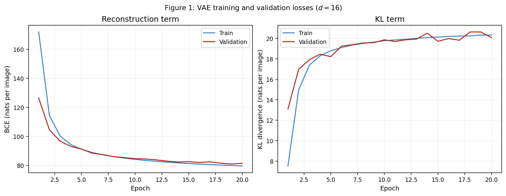
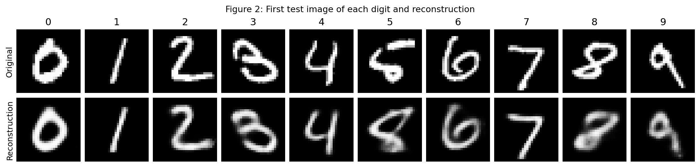
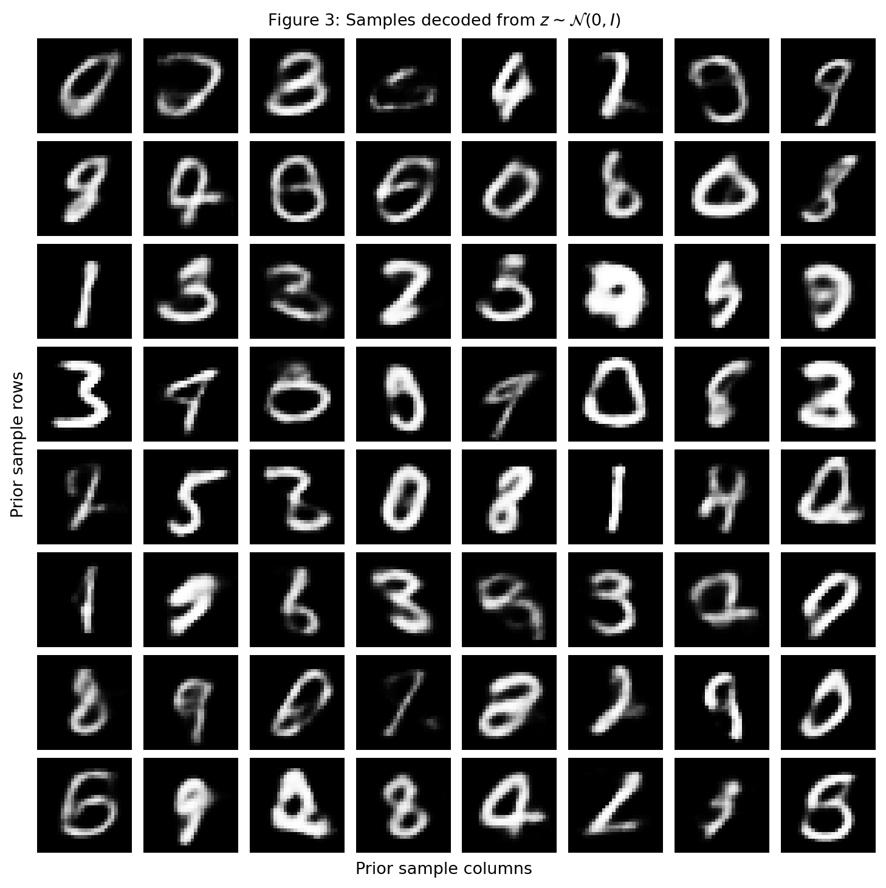
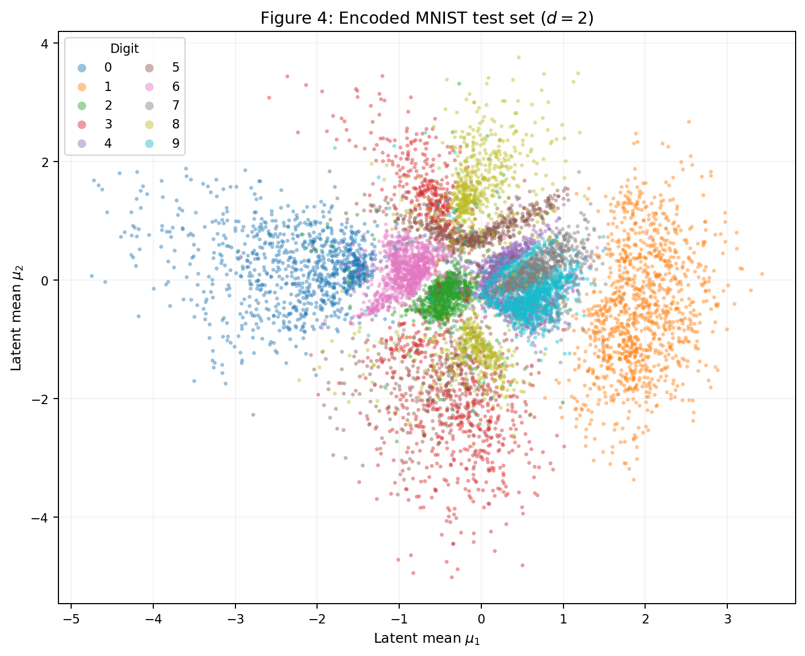
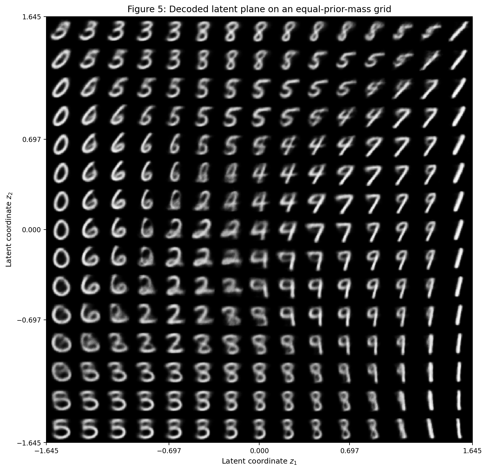
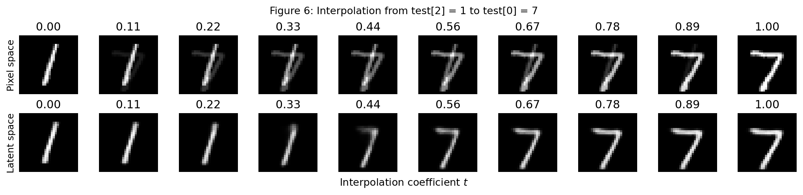

# 4 · Variational Autoencoder

This report studies the tension at the center of a variational autoencoder: the model must reconstruct each input while keeping its latent distribution close enough to a known prior that new samples can be drawn from it. The first exercise trains a 16-dimensional VAE on MNIST and the second compresses the same problem into two latent dimensions so that this trade-off becomes visible.

!!! info "Reproducibility"
    Both models use `torch.manual_seed(42)` immediately before construction. MNIST is split into 50,000 training and 10,000 validation images with `torch.Generator().manual_seed(42)`. The official 10,000-image test set is consulted only after training. The complete implementation is in [`vae_activity.py`](code/vae_activity.py).

??? "See `vae_activity.py`"
    ```python
    --8<-- "docs/exercises/vae/code/vae_activity.py"
    ```

## Exercise 1: a VAE on MNIST

### A — Load and split the data

MNIST was loaded through `torchvision.datasets.MNIST` and `transforms.ToTensor()`, which maps each pixel to $[0,1]$. Each $28\times28$ image is flattened into a 784-dimensional vector before entering the model.

The 60,000 original training images were split exactly as described:

```python
train, validation = random_split(
    train_full,
    [50_000, 10_000],
    generator=torch.Generator().manual_seed(42),
)
```

Training decisions use only the training and validation subsets. The official 10,000-image test set is evaluated once, after the 20 training epochs of each model.

### B — Build the model

The 16-dimensional model uses the prescribed fully connected architecture:

| Component | Layers and activations |
| --- | --- |
| Encoder | $784\to512\to256$, ReLU after each layer |
| Distribution heads | separate $256\to16$ layers for $\mu$ and $\log\sigma^2$ |
| Decoder | $16\to256\to512\to784$, hidden ReLUs and sigmoid output |

The encoder returns $\mu$ and $\log\sigma^2$. Sampling is made differentiable with the reparameterization trick:

$$
\epsilon\sim\mathcal N(0,I), \qquad
\mathbf z=\mu+exp\left(\tfrac12\log\sigma^2\right)\odot\epsilon.
$$

For a batch of size $N$, the implementation computes the reconstruction and regularization terms explicitly:

$$
L_{\mathrm{BCE}}
=-\frac1N\sum_{n=1}^N\sum_{j=1}^{784}
\left[x_{nj}\log\hat x_{nj}+(1-x_{nj})\log(1-\hat x_{nj})\right],
$$

$$
L_{\mathrm{KL}}
=\frac1{2N}\sum_{n=1}^N\sum_{i=1}^{d}
\left(\mu_{ni}^2+\exp(\log\sigma_{ni}^2)-1-\log\sigma_{ni}^2\right),
$$

$$
L=L_{\mathrm{BCE}}+\beta L_{\mathrm{KL}}, \qquad \beta=1.
$$

The BCE is summed over the 784 pixels before division by the batch size. Using a pixel-wise mean would reduce it by a factor of 784 relative to the KL and silently change the intended trade-off.

BCE corresponds to the negative log-likelihood of Bernoulli pixels, matching a sigmoid decoder whose values represent the probability that a pixel is on. Squared error would instead correspond to a Gaussian observation model. MNIST is nearly binary, so the Bernoulli assumption is appropriate here.

### C — Train

The model was trained with Adam, learning rate $10^{-3}$, batch size 128, and 20 epochs. Reconstruction and KL were logged separately, in nats per image, for both the training and validation sets.



The final test results are:

| Latent dimension | Reconstruction | KL | Negative ELBO |
| ---: | ---: | ---: | ---: |
| 16 | **80.8944** | **20.1099** | **101.0043** |

All values are nats per image. The validation KL increases from **13.1045** at epoch 1 to **20.0820** at epoch 20.

### D — Reconstructions and samples

Figure 2 uses the first test image of each digit. Each reconstruction is produced by decoding $\mu$ directly, without sampling $\mathbf z$.



For Figure 3, `torch.manual_seed(0)` was set and 64 independent vectors were sampled from $\mathcal N(0,I)$ and decoded into an $8\times8$ grid.



### E — Analysis

#### 1. Why does the KL rise while the total loss falls?

At the beginning of training, the encoder is close to the standard-normal prior but carries little useful information, so the KL is low and reconstruction is poor. The optimizer discovers that moving the approximate posteriors away from the prior allows $\mathbf z$ to encode digit identity, stroke position, and style. It therefore accepts a larger KL penalty because the resulting reduction in reconstruction BCE is larger. In this run, validation KL rises from 13.1045 to 20.0820 while validation reconstruction falls from 126.512 to 81.445 nats per image. The objective improves because the reconstruction saving outweighs the extra regularization cost.

#### 2. Why are prior samples worse than reconstructions?

There are two distinct causes:

1. The KL encourages each encoded distribution toward $\mathcal N(0,I)$, but the aggregated posterior does not cover the prior perfectly. A random prior sample can therefore fall in a sparsely trained region or between digit clusters, where the decoder has little evidence for a clean digit.
2. For a fixed $\mathbf z$, the sigmoid decoder predicts Bernoulli means pixel by pixel. When several plausible strokes or digits are compatible with that location, the likelihood objective averages them. Mutually exclusive strokes receive intermediate intensity, producing blur rather than choosing one crisp alternative.

Figure 2 starts from latent means of real test images and consequently lands in well-supported regions. Figure 3 includes more ambiguous, incomplete, and blurred outputs because its points come directly from the prior.

#### 3. Why decode the latent mean for reconstructions?

$\mu$ is the deterministic center of $q(\mathbf z\mid\mathbf x)$ and therefore isolates what the encoder-decoder pair retained about the input. Sampling would add $\epsilon$ noise, so differences in Figure 2 would mix reconstruction quality with random variation. Decoding the mean makes the comparison stable and reproducible.

---

## Exercise 2: a Latent Space You Can See

### A — Train a 2-D VAE

The second model changes only the latent dimension from 16 to 2. It uses the same data split, seed, architecture widths, $\beta=1$, optimizer, batch size, learning rate, and 20-epoch budget.

| Latent dimension | Reconstruction | KL | Negative ELBO |
| ---: | ---: | ---: | ---: |
| 16 | 80.8944 | 20.1099 | 101.0043 |
| 2 | **135.8284** | **6.5465** | **142.3749** |

The two-dimensional bottleneck pays a smaller KL because it has only two coordinates to regularize, but its reconstruction cost is 54.9340 nats higher. The negative ELBO is therefore substantially worse.

### B — The encoded test set

Figure 4 plots $\mu$ for all 10,000 test images, colored by their true digit.



The latent space organizes digits into recognizable regions, but the classes are not isolated islands. Broad overlaps are visible around the center, especially among 3, 5, and 8 and among 4, 7, and 9.

### C — The decoded plane

Figure 5 decodes a $15\times15$ grid. Its coordinates are not linearly spaced: each axis uses

$$
z=\Phi^{-1}(q), \qquad q\in\operatorname{linspace}(0.05,0.95,15).
$$

Equal steps in $q$ correspond to equal-probability intervals under a standard normal, so each grid cell represents the same prior mass rather than the same Euclidean width.



### D — Interpolation

The interpolation endpoints are **test index 2 (digit 1)** and **test index 0 (digit 7)**. For ten equally spaced values of $t\in[0,1]$, the top row uses the direct pixel interpolation

$$
(1-t)\mathbf x_a+t\mathbf x_b,
$$

while the bottom row decodes the interpolation between the two 16-D latent means:

$$
\operatorname{decode}\left((1-t)\mu_a+t\mu_b\right).
$$



### E — Analysis

#### 1. Which digits overlap, and where is the same transition decoded?

Figure 4 shows substantial overlap among digits **3, 5, and 8** in the vertical central band and among **4, 7, and 9** near the dense center-right region. These are visually related digits: small changes can close a loop, remove a stroke, or turn the top of a 4 or 9 into a 7-like form.

Figure 5 displays the same ambiguity. Moving through the central and center-right portion of the plane produces smooth 4-to-9-to-7 transitions, with intermediate images that have a vertical stem and a partially closed upper loop. In the central vertical region, 3-, 5-, and 8-like shapes share or gradually gain and lose loops. The decoded grid therefore turns the colored overlap in Figure 4 into visible morphological transitions.

#### 2. What does the two-dimensional bottleneck discard?

Two numbers cannot preserve all independent variations present in a $28\times28$ digit: identity, stroke thickness, slant, width, loop closure, local curvature, and translation must compete for the same coordinates. The model keeps the large-scale features needed to arrange digit families, but discards fine details and unusual handwriting styles. Figure 5 supports this: it contains smooth, prototypical digits and gradual transitions, but far less within-digit variety than the original dataset. This information loss explains the reconstruction increase from 80.8944 to 135.8284 nats.

#### 3. Pixel interpolation versus latent interpolation

The latent-space row passes through images that continue to look like handwritten digits: the decoder turns nearby latent vectors into points on its learned digit manifold, gradually extending the top stroke of the 1 until it becomes a 7. The pixel-space row instead overlays the two endpoint images. Its intermediate frames contain translucent or doubled strokes because a straight line in 784-dimensional pixel space is not constrained to follow the data manifold. Pixel averages are valid arrays, but they are not necessarily plausible MNIST samples.

---

## Results summary

| # | Quantity | Value |
| ---: | --- | --- |
| 1 | Ex. 1 — test reconstruction, KL, and negative ELBO ($d=16$) | 80.8944, 20.1099, and 101.0043 nats/image |
| 2 | Ex. 1 — validation KL at first and last epoch | 13.1045 and 20.0820 nats/image |
| 3 | Ex. 2 — test reconstruction and KL ($d=2$) | 135.8284 and 6.5465 nats/image |
| 4 | Ex. 2 — interpolated test indices | Index 2 (digit 1) and index 0 (digit 7) |
